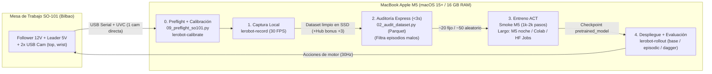

# Plan Maestro: Physical AI Hackathon Bilbao — Edición Apple Silicon MPS + Nube Híbrida

> [!IMPORTANT]
> **Arquitectura Híbrida para MacBook Apple M5 (16 GB Memoria Unificada / MPS):**
> El chip **Apple M5** con **16 GB de memoria unificada** y aceleración Metal (`mps`, requiere **macOS 15+**) permite capturar demostraciones a 30 Hz, validar flujos con *smoke tests* locales y ejecutar inferencia de políticas **ACT** a **`53.8 Hz`** (`18.5 ms/frame`) directamente en el portátil sin depender del Wi-Fi del recinto.
> Para entrenamientos largos (`20.000–40.000` pasos), ten en cuenta la velocidad real medida en M5 (`~1.65 s/paso` con `batch_size=8` -> `10.000 pasos ≈ 4.5 h`): combina **entreno nocturno local en M5** con **Google Colab** o **Hugging Face Jobs** (`--job.target=a10g-small`) según la guía oficial (`https://hackathonbilbao.eus/guia-so-101`).

---

## 1. Pipeline Operativo (La Perrera Espazioa, Bilbao)

---

## 2. Reglas de Oro de Hardware, Memoria y Estrategia (Guía Oficial SO-101)

| Parámetro / Componente | Configuración Óptima | Por qué es crítico en el Hackathon |
| :--- | :--- | :--- |
| **Versión LeRobot** | `lerobot==0.7.0` | Versión oficial de la guía de Bilbao (`--dataset.no_stamp`, `rollout_*`, `lelab`). |
| **Alimentación y Cables** | Etiquetar `5 V` Leader vs `12 V` Follower | Nunca intercambiar fuentes ni enchufar/desenchufar cables con alimentación puesta. |
| **Topología USB y Cámaras** | Hub con fuente propia + **1 cam directa al Mac** | Conectar 2 cámaras + 2 brazos en un hub sin corriente provoca cortes o caídas a 15 FPS. |
| **Resolución de Cámara** | `640x480` @ `30fps` (`MJPG`) | `1080p` sin comprimir satura el bus USB 2.0 y multiplica 4x el coste de decodificación. |
| **Permisos macOS** | Monitorización de entrada para Terminal | Imprescindible para que funcionen `→`/`←`/`Esc` al grabar y `Space`/`Tab` en DAgger. |
| **Arquitectura Principal** | `ACT` (`--policy.type=act`) | Converge rápido (`10k–15k` pasos tarea fija, `30k–40k` aleatorio) y corre a `>50 Hz` en M5. |
| **Dispositivo y Batch M5** | `--policy.device=mps --batch_size=8 --num_workers=2` | Evita presión de memoria unificada (>12 GB activaría *swap* en SSD). |
| **Tiempos Reales de Entreno** | Smoke `1k-2k` pasos (~28–55 min M5) · Largo `20k-40k` | En M5 (`~1.65 s/paso`), `10k` pasos son ~4.5 h; usa M5 de noche o Colab/HF Jobs de día. |
| **Publicación & Bonus** | Dataset en HF Hub (`+3`) + Repo reproducible (`+2`) | Hasta `+5` puntos extra directos sobre los 100 puntos de la rúbrica del jurado. |
