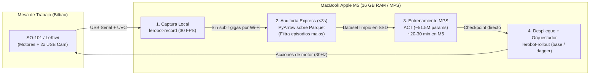

# Plan Maestro: Physical AI Hackathon Bilbao — Edición 100% Local (Apple Silicon MPS)

> [!IMPORTANT]
> **Arquitectura 100% Local en Apple Silicon (16 GB Memoria Unificada / MPS):**
> El chip **Apple M5** con **16 GB de memoria unificada** y aceleración Metal (`mps`) permite entrenar políticas **ACT (Action Chunking with Transformers)** y ejecutar inferencia a **`53.8 Hz`** directamente en el portátil durante el hackathon, **sin depender de cuentas Cloud ni sufrir por el Wi-Fi saturado del recinto**.

---

## 1. Pipeline 100% Local "Zero-Latency"

---

## 2. Reglas de Oro para Entrenar en 16 GB de Memoria Unificada sin OOM

| Parámetro / Componente | Configuración Óptima | Por qué es crítico en el Hackathon |
| :--- | :--- | :--- |
| **Arquitectura Principal** | `ACT` (`--policy.type=act`) | Solo `51.5M` parámetros (`197 MB`). Converge 4x más rápido que Diffusion (`263M` params) y cabe holgado en 4 GB de memoria. |
| **Dispositivo** | `--policy.device=mps` | Usa los núcleos GPU y aceleradores matriciales de Apple Silicon. |
| **Batch Size** | `--batch_size=8` | Evita presión de memoria unificada (>12 GB activaría *swap* en SSD). |
| **Workers del DataLoader** | `--num_workers=2` | En macOS (`spawn`), cada worker duplica estructuras en RAM. Con `2` maximizas decodificación MP4 sin agotar los 16 GB. |
| **Resolución de Cámara** | `640x480` @ `30fps` (`MJPG`) | Capturar a `1080p` sin comprimir satura el bus USB 2.0 y multiplica por 4x el tiempo de CPU en decodificar vídeo. |
| **Pasos de Entrenamiento** | `--steps=5000` a `10000` | Con `batch_size=8` y 40 episodios (~12.000 frames), 10.000 pasos son ~6.6 épocas completas. |
